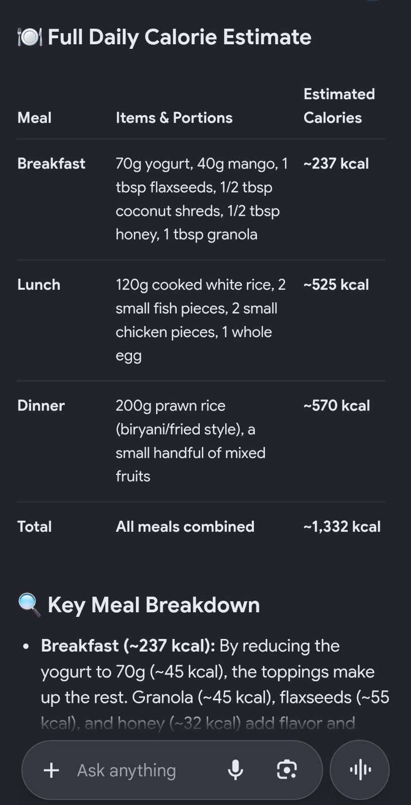
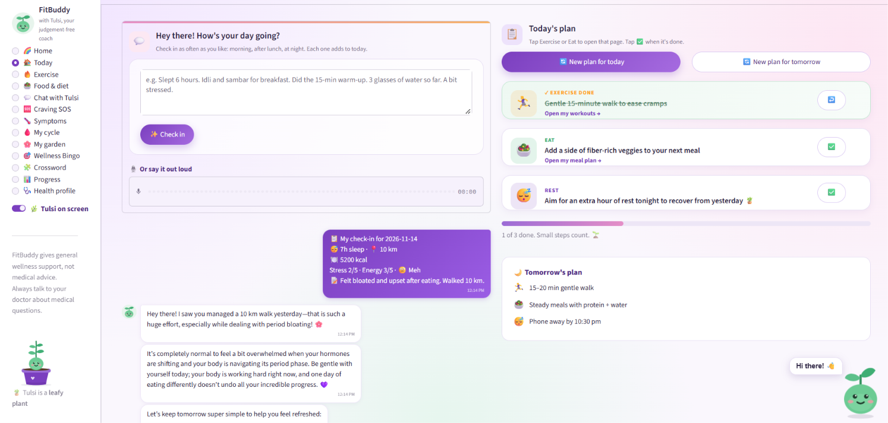
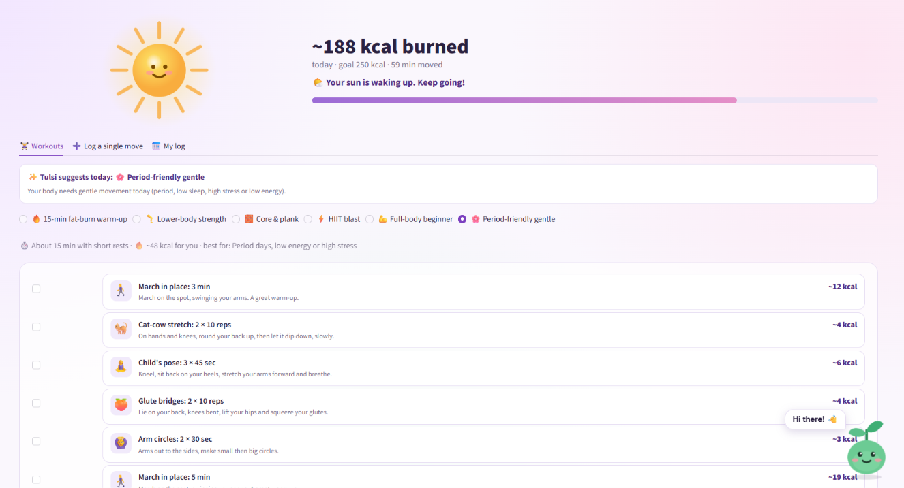
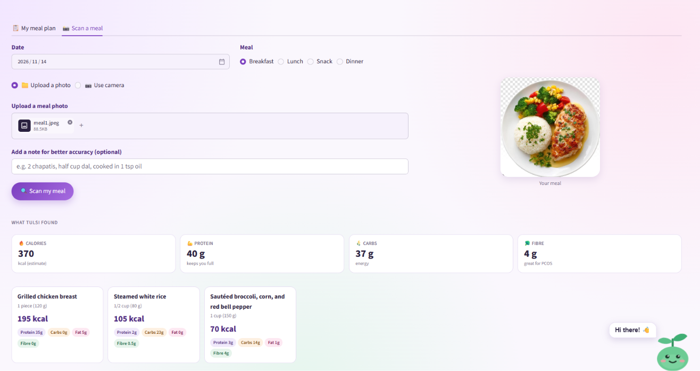
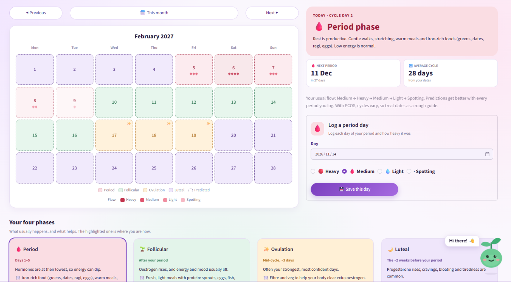

# FitBuddy

**A kind, judgement-free AI health coach for women with PCOS, built around a character called Tulsi.**

FitBuddy helps you lose weight and build healthy habits at home, with no gym, no shaming and no extreme diets.
It plans specific workouts and meals, reads your food photos, tracks your cycle, and adjusts its advice to your
sleep, stress and cycle phase.

## Why I built it

I went from 80 kg to 63 kg in about a year, at home, with AI as my coach. I have PCOS and was on medication from
2018 to February 2026; after losing the weight, my cycle became regular again.

What worked for me was simple and specific: a **15-minute warm-up every morning** (squat jumps, mountain climbers,
skipping rope), **more cardio in the evening**, along with strength moves like planks, lunges and squats, and a **planned diet**
with a calorie deficit. Together, they helped me lose weight I once thought was impossible to lose.

I also know what it feels like to be body-shamed, and how stress and poor sleep raise cortisol and make weight
harder to lose. Most fitness apps ignore all of that. FitBuddy is the coach I wish I'd had: specific, encouraging,
and aware of PCOS.

### Where the idea came from

<p align="center"></p>

Every day for the past year, I had conversations like this one with AI: what I ate and how many calories it was,
which exercises wouldn't spike my cortisol, and how big my calorie deficit should be. Through these conversations
I achieved something I thought was impossible.

But I had to do it all by hand: typing out every meal, asking the same questions again, and keeping track of
everything myself. FitBuddy turns that daily routine into an app. It remembers my profile, cycle and progress,
plans my workouts and meals, and gives the same kind, specific help, without starting from scratch every day.



---

## Main pages

### Today

The daily home base, split into two halves.

- **Check in as often as you like.** Describe your day in your own words, typed or spoken, for example
  *"Slept 6 hours. Idli and sambar for breakfast. Did the 15-min warm-up. A bit stressed."*
  The AI turns it into structured data: sleep, meals, exercise, water, stress, mood and symptoms. You see what it
  understood and confirm with one tap. Every check-in adds to the day and appears in a timeline.
- **Today's plan as three cards: Exercise, Eat and Rest.** Exercise and Eat open their pages; each card can be
  marked done. Two buttons create a plan for **today** or **tomorrow**. The AI must name specific moves and meals,
  and it makes plans smaller on low-sleep or high-stress days and bigger when you're following through well.
- Tulsi replies to each check-in like a friend, in short chat bubbles.

### Exercise



- **Six ready-made home workouts with exact sets and reps**: a 15-minute fat-burn warm-up (jumping jacks 2 × 45 sec,
  high knees 2 × 30 sec, squat jumps 3 × 10, mountain climbers 3 × 30 sec, 3 min skipping rope), lower-body strength,
  core and plank, HIIT, full-body beginner, and a gentle period-friendly session.
- Every move has a short how-to and an **estimated calorie burn for your body weight**.
- Tick the moves you finished, or log a single move (for example *Plank, 3 × 60 sec* or *Lunges, 3 × 12*).
- Tulsi **suggests a workout for today** based on your cycle phase, sleep, stress and energy.
- A sun gets brighter as you approach your daily burn goal, and a log shows today and the past week.
  Walks recorded by Samsung Health are included automatically.

**How calories are estimated:** calories ≈ MET × weight (kg) × time (hours), using standard MET values for each move.
Rest between sets is counted at a light MET of 3, so totals stay realistic (the 15-minute warm-up is about 97 kcal
at 63 kg). These are estimates, and the app says so.

### Food & diet (meal plan and food scan)



**Meal plan**
- A **daily calorie target** from your height, weight and age (Mifflin-St Jeor formula × 1.375 for light activity,
  minus a gentle 400 kcal), never below 1,200 kcal, plus a **protein goal** of 1.2 g per kg.
- Four specific, PCOS-friendly Kerala and Indian meals with portions, calories and protein, for example
  *puttu (½ cup) + kadala curry (¾ cup)* or *½ cup matta rice + fish curry*. Vegetarian, eggs + veg, or non-veg.
- **Swap** any meal, and tap **I ate this** to log it. A progress bar shows eaten vs target, and the app suggests
  easy protein add-ons when the plan is low.

**Food scan**
- Take or upload a photo of your meal. Gemini identifies each food (including Kerala dishes) and estimates calories,
  protein, carbs, fat and fibre.
- Adjust the servings you actually ate and edit anything before saving.
- A sanity check flags results where the calories don't match the protein, carbs and fat
  (about 4 kcal per gram of protein or carbs, 9 per gram of fat).

### My cycle (period tracker)



- **Log each period day with its flow**: heavy, medium, light or spotting. A new period starts automatically when
  there was no flow in the two days before.
- A **month calendar coloured by phase**: period, follicular, ovulation and luteal. Period days show flow drops,
  and **predicted** periods and phases have dashed borders.
- Predictions learn from your own data: your average cycle length and your usual flow pattern
  (for example *Medium → Heavy → Heavy → Light → Spotting*). Irregular PCOS cycles are flagged.
- Four phase cards explain what usually happens in each phase and what helps with food and exercise.
  The current phase is highlighted.
- The cycle phase feeds into the rest of the app: workout suggestions, meal advice and Tulsi's replies.

---

## More features

- **Chat with Tulsi**: free chat or one-tap requests (7-day meal plan, lunchbox ideas, home workout, grocery list,
  motivation, sleep tips). Voice input, and optional spoken replies.
- **Craving SOS**: type exactly what you're craving (*"Dairy Milk"*, *"chicken biryani"*, *"Maggi at 11 pm"*) and get
  three specific swaps for that food, plus a kind tip for enjoying the real thing. Over time it shows your craving
  patterns by time of day, trigger and cycle phase.
- **Symptoms**: log seven PCOS symptoms and see a 30-day grid and averages by cycle phase. Links with sleep, stress,
  water and cycle phase are checked with a permutation test and a Benjamini–Hochberg correction, so chance patterns
  aren't reported as real.
- **Progress**: imports a Samsung Health export (CSV or .zip) and charts steps, walks, sleep and weight. The weight
  chart shows a 7-day average, and when the scale goes up, the app explains likely temporary causes from your own data.
- **My garden**: Tulsi grows from a seed to full bloom as you progress and make an effort. She never wilts.
  Each glass of water you log waters her. Includes badges, a non-scale wins journal and a shareable progress card.
- **Wellness Bingo and Crosswords**: a weekly self-care bingo card and newspaper-style crosswords (daily, by theme,
  or on any theme you type) to share with friends.
- **Health profile and doctor report**: conditions, medications and goals; the AI summarises an uploaded medical
  report (you confirm before saving); and a one-page PDF summary for doctor visits.
- **Phone reminders**: download a calendar file and your phone reminds you daily, even when the app is closed.

## Responsible AI design

- Tulsi never shames, never says to "burn off" food, and never suggests eating under 1,200 kcal or extreme diets.
- No medication advice. Medical questions are sent back to your doctor.
- Advice is cortisol-aware: gentle movement and rest on low-sleep or high-stress days.
- The AI's understanding of your check-in or food photo is always shown to you to confirm or edit before saving.
- All calorie and cycle numbers are labelled as estimates.
- Health data stays on your own computer (local JSON files that are excluded from Git), and the app asks for consent
  before saving it.

## How it works

| Part | What it does |
|---|---|
| Streamlit | The app and all pages (`app.py`, styling in `ui.py`) |
| OpenRouter (free model) | Tulsi's chat, check-in understanding, plans and crossword clues (`coach.py`) |
| Google Gemini | Food photo recognition (`food.py`), voice transcription, and backup for chat |
| Fallback chain | If one model is busy or fails, the app automatically tries the next one |
| Plain Python | Workouts and calories (`exercise.py`), meal plans (`diet.py`), cycle predictions (`cycle.py`), patterns and statistics (`journey.py`) |
| Local JSON files | All personal data, stored in `data/` on your computer |

The AI is used where it adds real value (understanding free text and photos, writing kind, personal replies).
Anything that should be exact and repeatable, such as calorie maths, meal targets and cycle dates, is plain code.

## Run it (Windows)

```
python -m venv venv
venv\Scripts\activate
pip install -r requirements.txt
copy .env.example .env
notepad .env
streamlit run app.py
```

In `.env`, paste your free API keys from [OpenRouter](https://openrouter.ai/keys) and
[Google AI Studio](https://aistudio.google.com/apikey). Never commit the `.env` file.

The development story, step by step, is in [DEVLOG.md](DEVLOG.md).

*FitBuddy gives general wellness support, not medical advice. Always talk to your doctor about medical questions.*
